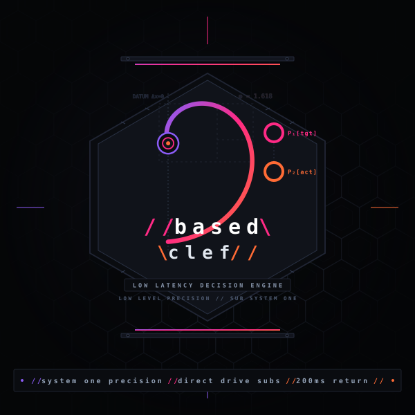
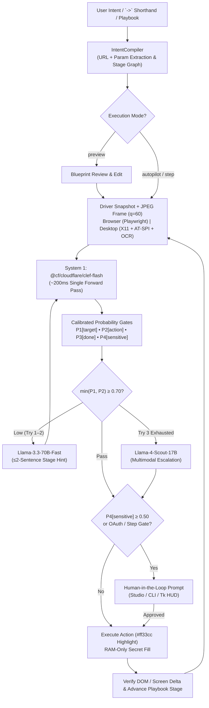

<div align="center">



# `based-clef`

**Sub-second System 1 computer-use agent powered by Cloudflare Clef decision models, Intent-to-Playbook compilation, an interactive Web Studio, and Human-in-the-Loop safety gates.**

[](pyproject.toml)
[](LICENSE)
[](docs/clef_ref.md)
[](decision_agent/mcp_server.py)

</div>

---

## Why Based Clef?

Most computer-use agents stream autoregressive vision-language tokens on every UI frame — burning **3–8 seconds** and thousands of output tokens just to click a button.

**Based Clef** replaces token-by-token generation with **System 1 calibrated classification** (`@cf/cloudflare/clef-flash`):
1. **Intent → Action Sequence Blueprint**: Natural language goals (or `->` pipeline shorthand) compile into an inspectable, editable sequence of UI `Stage`s before acting.
2. **Single-Pass ~200 ms Probability Gates**: On each step, Clef evaluates four calibrated heads simultaneously — `P1[target]`, `P2[action]`, `P3[done]`, and `P4[sensitive]` — over a pruned DOM/accessibility tree + 1 JPEG viewport frame.
3. **3-Tier Adaptive Escalation Ladder**: Only when Clef confidence drops below `0.70` does Based Clef invoke a fast hint rewriter (`Llama-3.3-70B-Fast`) or multimodal escalation (`Llama-4-Scout-17B`).
4. **Zero-Leak Secret Isolation & HITL Gates**: Passwords and API tokens stay strictly in RAM (never sent to Clef or LLMs, masked as `***` in DOM snapshots), and irreversible actions pause for explicit human approval.

---

## ⚡ Quickstart (Try in 30 Seconds — Even Without API Keys)

### 1. Install
Requires **Python 3.11+** and Google Chrome or Chromium (or Playwright's bundled Chromium).

```bash
git clone https://github.com/paschalla/based-clef.git
cd based-clef
python3 -m venv .venv
./.venv/bin/pip install -e ".[all]"

# Optional if Chrome/Chromium is not already installed on your machine:
./.venv/bin/playwright install chromium
```

### 2. Try Immediately in Local Sandbox Mode (Zero API Keys Needed)

```bash
# Run the bundled login demo end-to-end in headless Chrome/Chromium
./.venv/bin/bclef demo --offline --headless

# Run the multi-stage API Console demo (search -> filter -> generate key)
./.venv/bin/bclef demo --portal --offline --headless

# Launch Based Clef Studio in your browser (interactive Blueprint Editor + Live Viewport)
./.venv/bin/bclef studio --offline --open
```

### 3. Connect Cloudflare Workers AI (`@cf/cloudflare/clef-flash`)

Run the guided setup (`chmod 600` enforced automatically) and verify your environment:

```bash
./.venv/bin/bclef init
./.venv/bin/bclef doctor
```

<details>
<summary>Or configure <code>~/.config/based-clef/env</code> manually</summary>

```bash
mkdir -p ~/.config/based-clef && chmod 700 ~/.config/based-clef
cat << 'EOF' > ~/.config/based-clef/env
CLOUDFLARE_ACCOUNT_ID=your_32_char_account_id
CLOUDFLARE_API_TOKEN=your_workers_ai_api_token
BASED_CLEF_MODEL=@cf/cloudflare/clef-flash
EOF
chmod 600 ~/.config/based-clef/env
```
*(Legacy `~/.config/decision/env` and the `da` CLI alias remain 100% supported.)*
</details>

---

## 🎯 From User Intent to Action Sequence

Based Clef gives you **four intuitive ways** to express and control UI trajectories:

### 1. Natural Language (Auto-Extracts URLs & Search Queries)
No need to pass `--url` or `-d search=...` manually when your prompt already states them:

```bash
bclef run "Search wikipedia.org for 'Alan Turing' and open the article" --highlight
```

### 2. Clef Pipeline Shorthand (`->`)
Write crisp, deterministic multi-stage pipelines inline:

```bash
bclef run "Open https://news.ycombinator.com -> click 'Newest' -> scroll down"
```

### 3. Blueprint Preview & Co-Pilot Step Modes
Inspect, refine, or approve every stage before execution — or step through one decision at a time:

```bash
# Compile & inspect the Action Sequence Blueprint without executing a single click
bclef plan "Open github.com -> search 'cloudflare clef' -> open top repository"

# Pause after compiling so you can confirm or add guidance before step 1
bclef run "Log in and generate a staging API key" --url https://portal.example.com --preview

# Co-Pilot mode: confirm each calibrated action step interactively
bclef run "Review billing settings and update plan" --url https://portal.example.com --step
```

### 4. Reusable, Parameterized Playbooks (`.playbook.json`)
Record a verified run once (with zero secrets written to disk) and replay it anywhere:

```bash
# Save verified trajectory on completion
bclef run "Log in with the given email and password" \
  --url "file://$PWD/decision_agent/demo/login.html" \
  -d email=operator@example.com -d password=hunter2 \
  --save-playbook login.playbook.json

# Replay with fresh runtime credentials
bclef playbook login.playbook.json \
  --url "file://$PWD/decision_agent/demo/login.html" \
  -d email=alice@example.com -d password=s3cr3t
```

---

## 🖥️ Four Unified Control Surfaces

| Surface | Command | Best For |
| :--- | :--- | :--- |
| **Based Clef Studio (Web UI)** | `bclef studio` / `bclef run ... --ui web` | Visual Blueprint editing, live JPEG viewport with clickable DOM bounding boxes, real-time `P1`–`P4` probability gauges, and HITL modals. |
| **Rich Terminal HUD** | `bclef run "..."` | Fast terminal workflows with live 3-panel telemetry, stage checklist (`✓`/`▶`), and inline CLI prompts. |
| **Floating X11 HUD** | `bclef gui` / `bclef run ... --ui tk` | Always-on-top native Linux overlay alongside full desktop (`AT-SPI` + `Tesseract OCR`) or headed browser sessions. |
| **Agent Protocols (MCP & IPC)** | `bclef mcp` / `bclef ipc` | Exposing `compile_intent`, `browser_task`, `desktop_task`, `hold_agent`, and `send_agent_hint` to Claude, Cursor, Antigravity, or local socket scripts. |

---

## 📐 Architecture & 3-Tier Decision Ladder



---

## 🛡️ Security & Human-in-the-Loop Guarantees

- **Zero-Leak RAM Secret Isolation**: Values passed via `-d` or prompted interactively never touch Clef or LLM prompts, logs, or exported Playbooks. `<input type="password">` values are masked as `***` inside the DOM snapshot script.
- **Strict `0600` Vault Persistence**: Newly entered secrets persist to `~/.config/based-clef/secrets.env` (`0600`) **only after task success**, with an instant one-click **Redact** button.
- **Silent Hold (`Hold` / `Alt+H`)**: Freezes execution and cancels any in-flight model request immediately; releasing Hold re-observes the live screen cleanly from scratch.
- **Window Boundary Isolation (`DesktopDriver`)**: Crops screenshots and blocks `xdotool` clicks outside the target application window so the agent can never click its own terminal or HUD.

---

## 🐍 Python SDK

Both `based_clef` (canonical) and `decision_agent` (legacy-compatible) namespaces are included:

```python
import asyncio
from based_clef import Config, build, compile_intent_fast

async def main():
    pb = compile_intent_fast("Open https://example.com -> verify 'Example Domain'")
    cfg = Config.from_env()
    cfg.headless = True
    rt = build(cfg)
    ok = await rt.run_task(pb.goal, data={}, url=pb.start_url, playbook=pb)
    await rt.shutdown()
    print("Completed:", ok)

asyncio.run(main())
```

---

## 🛠️ CLI Reference

```text
bclef studio [--host 127.0.0.1] [--port 8765] [--offline] [--open]
bclef run <intent> [--url URL] [-d key=value] [--ui plain|tk|web] [--headless]
                   [--preview | --step | --mode autopilot|preview|step]
                   [--playbook file.json] [--save-playbook out.json]
                   [--driver browser|desktop] [--vision|--no-vision]
                   [--highlight|--no-highlight] [--threshold 0.70] [--offline]
bclef plan <intent> [--url URL] [-d key=value] [--json] [--save out.json]
bclef playbook <file.json> [-d key=value] [--url URL] [--headless] [--offline]
bclef demo [--portal] [--offline] [--headless] [--ui plain|tk|web]
bclef gui [task] [--url URL] [--driver browser|desktop]
bclef init
bclef doctor [--json]
bclef mcp
bclef ipc [--socket PATH]
bclef ask <question> [--options opt1 opt2] [--state "text or -"]
bclef tail [-n 100] [-f]
```

*(All commands are also available as `based-clef` and `da`.)*

---

## 📄 License

Licensed under the [Apache License 2.0](LICENSE). See [`CONTRIBUTING.md`](CONTRIBUTING.md), [`SECURITY.md`](SECURITY.md), and [`docs/clef_ref.md`](docs/clef_ref.md) for architecture invariants and contributor guidelines.
